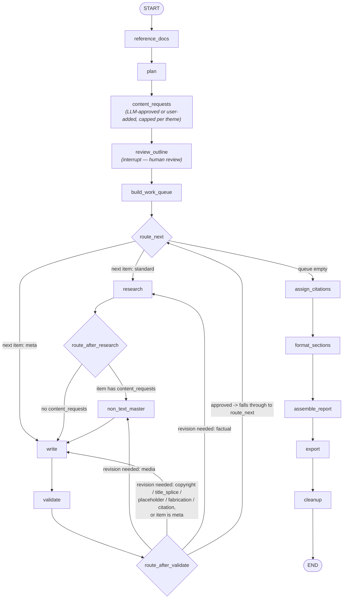

# Deep Research Assistant

An agentic report-generation pipeline, built on **LangGraph**, that turns a topic into a
fully-cited, multi-format research report — with a human reviewing the outline in the
middle of the run.

Given a topic, it plans an outline, pauses for human review (edit sub-topics, set section
weightage, request specific charts/diagrams/images, upload your own media), then loops
research → non-text content → write → validate per section, before assigning citations,
formatting, assembling, and exporting the final report as Markdown, HTML, PDF, DOCX, JSON,
or XML.

## Why this exists

Most "AI writes a report for you" demos are a single long prompt. This project is instead
built as a graph of small, independently-testable steps with a real human-in-the-loop
checkpoint, because that's what a report you'd actually want to ship needs:

- **You review the plan before any writing happens.** The outline pauses for edits,
  section weighting, and media requests/uploads *before* a single word of the report is
  drafted — not after, when a rewrite is expensive.
- **Content that's generated, not hallucinated.** Charts are rendered by deterministic
  matplotlib code from a small LLM-produced spec (never LLM-generated *code*, never
  `exec`/`eval`'d); data tables come from `pandas.read_html`; images come from a licensed
  Unsplash source, not a raw image search.
- **Every claim gets a citation**, and a copyright-overlap check runs against web-sourced
  text before a section is finalized.
- **It fails toward a smaller model's real behavior, not its ideal behavior.** Every
  prompt/parser in this codebase was iterated against actual quantized-7B output — see
  the "Notes on building this" section below.

## Architecture



Full routing notes: [`agentic_core/GRAPH.md`](agentic_core/GRAPH.md).
Full design rationale / bug history from the original notebook prototype:
[`agentic_core/__init__.py`](agentic_core/__init__.py).

### Pipeline stages

1. **`reference_docs`** — extracts text from any user-uploaded reference material
   (PDF, scanned PDF via OCR, DOCX, HTML, images) *before* planning, so the outline can
   reflect what source material actually exists.
2. **`plan`** — asks the LLM for sub-topics per theme, one theme per call (a 7B model
   reliably drops later themes when asked for all of them in one shot).
3. **`content_requests`** — decides, per sub-topic, whether a data-table, diagram, or
   photo would help — run *before* the human review step so the reviewer can see every
   auto-decided request and attach their own file to any of them.
4. **`review_outline`** *(the one `interrupt()` point)* — hands the draft outline to the
   caller for edits: sub-topics, queries, content requests, per-section weightage, and
   user-supplied media.
5. **`build_work_queue` → research/non-text/write/validate loop** — per section: web
   search, non-text content generation/fetch, drafting, then validation (factual grounding,
   cross-section duplication, copyright overlap, media checks, source-title splicing,
   placeholder/fabrication/citation checks) with bounded corrective retries.
6. **`assign_citations` → `format_sections` → `assemble_report` → `export` → `cleanup`** —
   numbers citations (dropping any source no section actually cited inline), formats each
   section, assembles the title/TOC/citations, exports to the requested format, then
   deletes raw uploads/extracted text (only `outline.json` and the final report persist).

## Tech stack

| Concern | Choice |
|---|---|
| Orchestration | [LangGraph](https://github.com/langchain-ai/langgraph) (`StateGraph`, `interrupt()`/`Command(resume=...)`, checkpointer) |
| LLM | Provider-switchable: local GGUF via `llama-cpp-python`, or Gemini via `langchain-google-genai` — same `.invoke()` interface either way |
| Web search | [Serper](https://serper.dev) API |
| Vision / SFW + copyright check on generated media | Gemini (`langchain-google-genai`) |
| Reference-doc extraction | pdfplumber, PyMuPDF, python-docx, BeautifulSoup, pytesseract+Pillow — matched to sections via TF-IDF/cosine similarity, no RAG/embeddings needed at this scale |
| Non-text content | Unsplash API (images), `pandas.read_html` (data tables), matplotlib (charts, from an LLM-produced JSON spec — never LLM-generated code), Mermaid (diagrams) |
| Export | markdown/json/xml natively; PDF via weasyprint; DOCX via pypandoc (both fall back to a markdown+note if their system dependency is missing) |
| Front-end | Streamlit (`front-end/`) |

## Project structure

```
agentic_core/          # the graph itself
  constants.py          - MAX_REVISIONS, COPYRIGHT_OVERLAP_THRESHOLD, DATA_DIR, ...
  config.py             - ResearchConfig, ReportConfig
  services.py           - LLM/search/vision-checker builders + text helpers
  content.py             - non-text content generators (images, tables, charts, diagrams)
  state.py                - ResearchState and friends (LangGraph state shape)
  reference_docs.py      - reference-doc extraction + TF-IDF matching
  nodes_plan.py           - plan / content_requests / review_outline / build_work_queue
  nodes_research.py       - research / non_text_master / write / validate + routing
  nodes_output.py         - citations / formatting / assembly / export / cleanup
  graph.py                - build_graph() wiring + a __main__ demo
  GRAPH.md                - generated mermaid diagram + routing notes
front-end/              # Streamlit app (Home.py, pages/, components/, services/)
tests/                  # numbered smoke-test ladder, see below
fakes.py                # fake LLM/search/vision-checker for graph-wiring tests
```

## Getting started

```bash
pip install -r requirements.txt
cp .env.example .env   # then fill in your API keys
```

Required keys (see `.env.example` for the full list with explanations):
`SERPER_API_KEY` (web search), `UNSPLASH_ACCESS_KEY` (images), `GOOGLE_API_KEY`
(Gemini text + vision, when using the default `gemini-2.5-flash-lite` provider).

### Run the graph directly

```bash
python -m agentic_core.graph
```

This runs the `__main__` demo in `graph.py`: it plans an outline, pauses for review,
prints the draft outline to edit, resumes with your edits, and prints the final report.

### Run the Streamlit front-end

```bash
streamlit run front-end/Home.py
```

## Testing

No mocking of the graph itself — a numbered smoke-test ladder in `tests/`, cheapest first:

- `00_check_dependencies.py` — verifies required packages/binaries are present.
- `01_test_pure_functions.py`, `02_test_reference_docs.py` — pure-function and
  reference-doc-extraction unit tests, no LLM/API needed.
- `03_test_single_nodes.py` — individual node tests.
- `04_test_full_graph_with_fakes.py` — validates graph wiring (routing, interrupt/resume,
  validation loop, export) against `fakes.py` stand-ins — no GPU, model file, or API keys.
- `05_test_real_llm_only.py`, `06_test_real_search_only.py`, `07_test_real_deepsearch.py` —
  real model/API integration tests.

## Notes on building this

This project was built by iterating directly against a real quantized 7B model's actual
output, not its ideal output — a few examples of what that meant in practice:

- Sub-topic and content-request generation ask for a flat, pipe-delimited line
  (`Sub-topic | query one | query two`) instead of JSON, because a small instruct model
  reliably mangles nested JSON (smart quotes, dropped commas, wrong key names) in ways a
  flat line format sidesteps entirely.
- Cross-section duplication is caught and fixed in code (near-duplicate sentence removal),
  not by asking the model not to repeat itself — telling it "don't repeat that" or "continue
  from this text" was tried and wasn't reliably followed.
- Mermaid diagrams are validated against mermaid's actual grammar (including escaping
  labels that contain unquoted parentheses, which mermaid's real parser — not just this
  project's own validator — treats as a different node shape) before being embedded in
  the report.

Three real bugs from an earlier notebook prototype are documented (and guarded against)
in [`agentic_core/__init__.py`](agentic_core/__init__.py) — kept as a record of the kind of
subtle, easy-to-reintroduce mistakes this rewrite specifically fixed.
