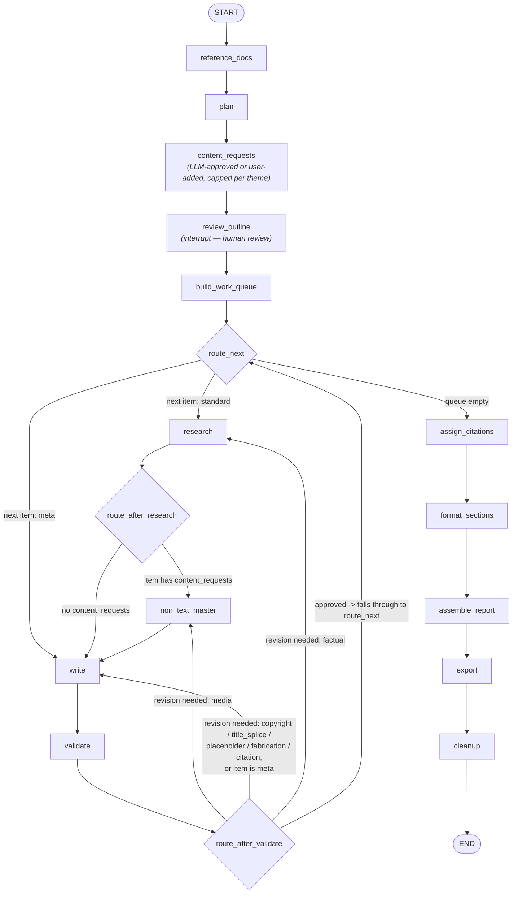

# Graph wiring

Generated from [`graph.py`](graph.py)'s `build_graph()` — nodes, edges, and the
three routing functions (`route_next`, `route_after_research`,
`route_after_validate`) that decide the conditional edges.

## Notes

- **review_outline** is the only interrupt point: the graph pauses here via
  `interrupt()` and resumes via `Command(resume={...})` once the caller
  (Streamlit) has the user's edited outline.
- **content_requests** is a one-time pass, right after `plan` builds
  `draft_outline` and BEFORE `review_outline`'s interrupt — deliberately
  ahead of the human review step, so the caller can show the user every
  auto-decided content request (alongside any added by hand) and let them
  attach a file per request before resuming, not just for requests they add
  themselves. Per theme, it asks the LLM about only its
  `MAX_CONTENT_REQUESTS_PER_THEME` sub-topics (taken in the order `plan`
  produced them — `weightage` isn't assigned until `review_outline` runs, so
  there's nothing else to rank by yet) whether a data-table/diagram/photo
  would help — not a target to hit, the model can decline every one. A
  sub-topic that already carries a content request (e.g. added by hand into
  `draft_outline` before this node runs) is left untouched here. A sub-topic
  the user adds *during* outline review gets no automatic content request —
  there's no later pass revisiting the outline, so the user must add one
  explicitly (`add_content_request()`) if they want non-text content for it.
- **route_after_research** routes to `non_text_master` whenever the current
  item has ANY content requests at all — including a fully user-supplied one
  with no real fetch needed, since `non_text_master_node` is also the only
  place that reads a user-supplied file into `current_media`. Skipping it
  whenever nothing needed fetching (the original logic) silently produced no
  media at all for user-supplied content.
- **route_after_validate** re-uses `route_next`'s decision once a section is
  approved (or has exhausted `MAX_REVISIONS`) — that's why its "approved" edge
  points back into the `route_next` diamond instead of duplicating its logic.
- A revision loop always re-enters at exactly one of `research` / `write` /
  `non_text_master` depending on `revision_kind` (`factual` / `copyright` /
  `media` / `title_splice` / `placeholder` / `fabrication` / `citation`) —
  `copyright`, `title_splice`, `placeholder`, `fabrication`, `citation`, and
  any `meta` item all route to `write` (a rewrite, no new research needed),
  `factual` routes to `research` for better source material — then always
  passes back through `write -> validate`. The four newer kinds are
  deterministic prose-quality checks added in `validate_node` (source-title
  splicing, empty `( )%` placeholders, invalid-quarter/year-for-citation
  fabrications, and invalid/mismatched citation numbers in the final prose)
  — see open-issues.md for the failure modes each one targets.
- For a `standard` item, `write_node` extracts short fact-pointers from that
  item's own Research Notes, drops any that duplicate a pointer already used
  by an earlier section (literal + semantic check, `used_pointers` state
  field), and writes only from the survivors — a positive "cover these
  specific facts" instruction rather than a negative "don't repeat that"
  one, which a small quantized model follows far more reliably.
- Cross-section duplication (any item kind, not just standard) is caught and
  fixed entirely in code inside `validate_node`, not via the revision-loop
  routing above — telling the model not to repeat itself (as a bulleted "already
  covered" list, or as "continue from this text") was tried twice and wasn't
  reliably followed either way, and a blind full-prompt retry often just
  reproduced the same duplicate again. `validate_node` instead strips any
  sentence that's a near-duplicate of something already written
  (`drop_duplicate_sentences`); if fewer than 3 sentences survive, it makes
  ONE narrow follow-up call asking for a couple more sentences and dedupes
  again; if that's still under 3, the section is dropped entirely (no more
  LLM calls — further attempts can't produce facts that aren't there), and
  any pointers it had claimed are freed back for a later section to
  legitimately claim instead of being wasted.
